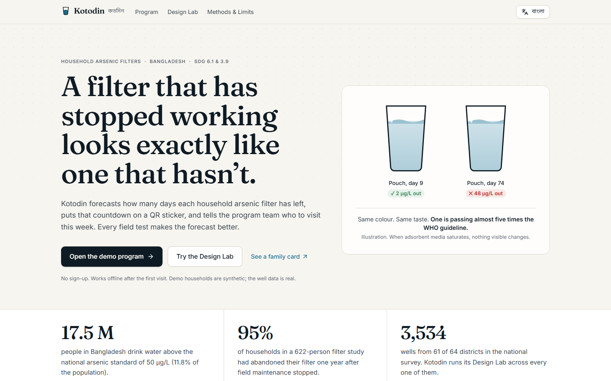
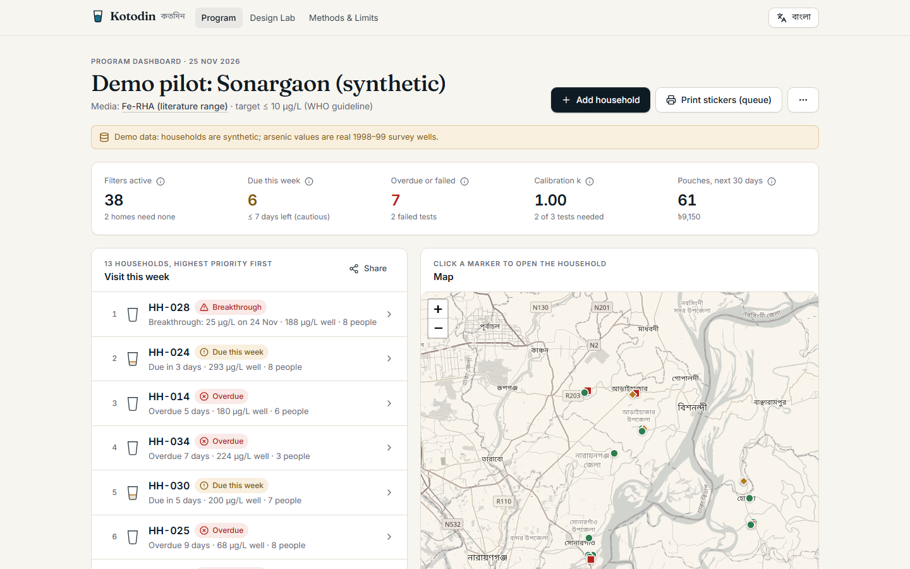
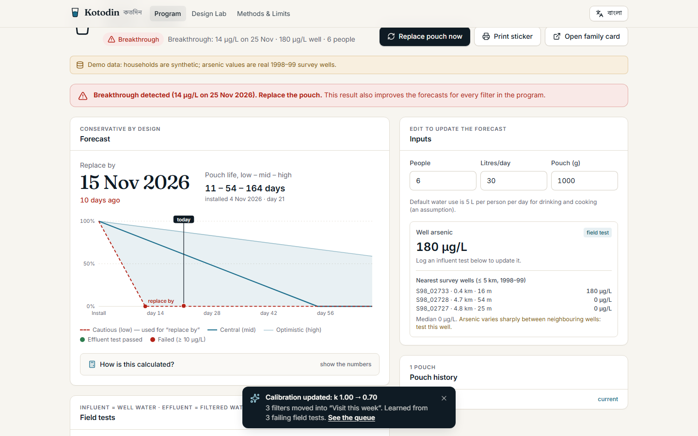
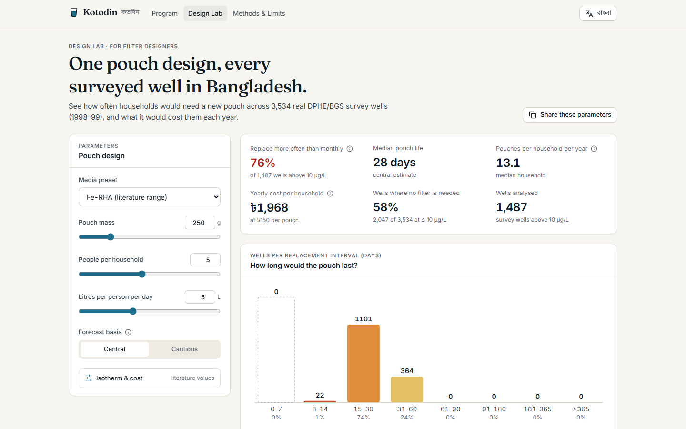
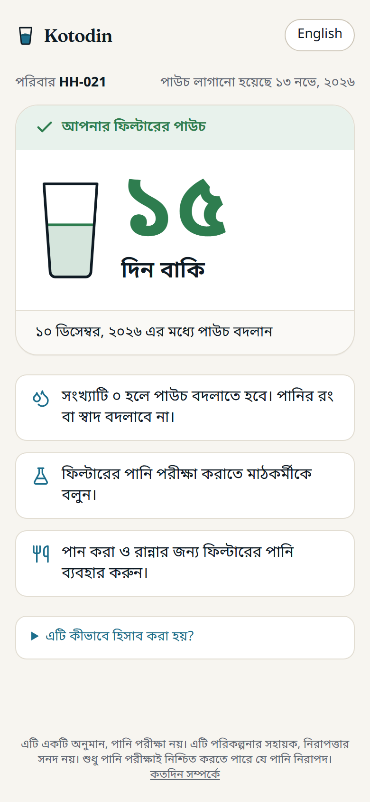
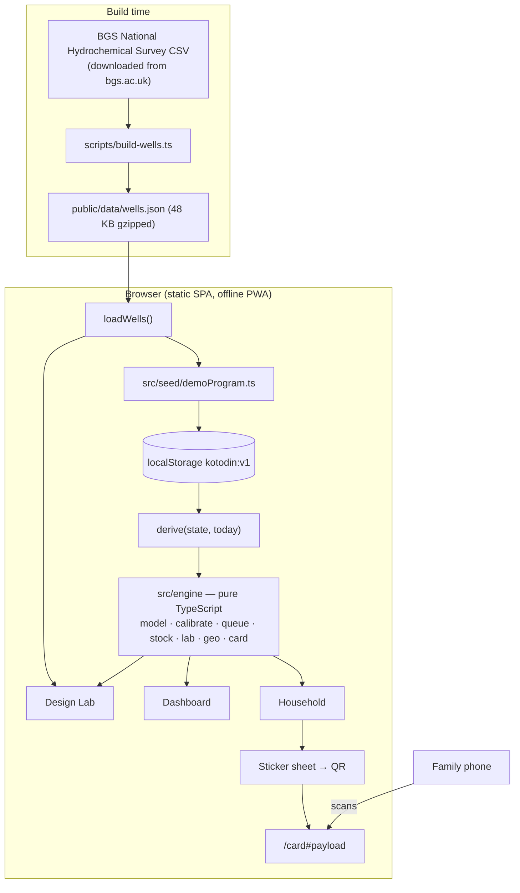

# Kotodin (কতদিন) — every arsenic filter runs out. Kotodin tells you when.

**Live app:** https://kotodin-cyan.vercel.app · **SDG targets:** 6.1, 3.9, 6.b · **Licence:** MIT



*Kotodin* means “how many days?” in Bangla. It forecasts, for each household, how many days an arsenic filter’s adsorbent pouch will keep water below 10 µg/L. It puts that countdown on a Bangla QR sticker on the filter and tells the program team which homes to visit this week. Every field test that catches a breakthrough recalibrates the forecast for the whole fleet.

## The problem

- About **17.5 million people** in Bangladesh (11.8%) drink water above the national arsenic standard of 50 µg/L ([MICS 2019](https://washdata.org/report/bangladesh-2019-mics-report)).
- Household filters are abandoned once field support stops. In a 622-participant study, **95% had abandoned the filter one year after maintenance ended** ([Sanchez et al. 2016](https://pmc.ncbi.nlm.nih.gov/articles/PMC4907796)). Support gaps and replacement costs recur as causes of failure ([Hanchett 2011](https://www.eawag.ch/fileadmin/Domain1/Abteilungen/sandec/publikationen/WST/Hanchett_2011.pdf)).
- **A saturated filter fails silently**: the water looks and tastes the same. Well arsenic ranges from under 10 to over 500 µg/L, so a fixed “replace every three months” rule is too late for some families and wasteful for others.

## What it does

| Surface | For | What you can do |
|---|---|---|
| **Program dashboard** `/program` | Field coordinators | KPIs, a *Visit this week* queue ranked by exposure × urgency with a plain-language reason, a status map, a sortable table, pouch-stock forecast (30/60/90 days), add households, export/import JSON, WhatsApp-share the visit list |
| **Household** `/program/h/:id` | Field workers | Replace-by date with a low–mid–high band, capacity chart, “How is this calculated?” with the real numbers substituted, field-test log, *Replace pouch now*, nearest survey wells |
| **Fleet calibration** | Programs | After ≥ 3 caught breakthroughs, k = median(observed ÷ predicted capacity) rescales every forecast, with a toast and highlighted rows |
| **Family card** `/card#…` | Households | Bangla-first countdown in Bangla numerals, status pictogram, three plain instructions. All data lives in the URL fragment: no server, no account, no names |
| **Sticker sheet** `/program/stickers` | Programs | A4 print layout, 8 QR stickers per page |
| **Design Lab** `/lab` | Filter designers | Run a pouch design across all 3,534 survey wells: histogram, yearly pouches and cost, a well map, and “find the pouch size” for a target |
| **Methods & Limits** `/methods` | Everyone | Every formula, parameter, source, assumption and limitation |

| Dashboard | Recalibration moment |
|---|---|
|  |  |
| **Design Lab** | **Family card (Bangla)** |
|  |  |

## How the forecast works

```
qe  = qmax · b · C / (1 + b · C)            Langmuir loading at well concentration C (mg/L)
Q   = mass · qe · derate · fBT · k          usable pouch capacity (mg As)
L   = C · litres per day                    daily arsenic load (mg/day)
D   = Q / L                                 days to breakthrough (low / mid / high bands)
replace by = install date + floor(D_low)    cautious by design
k   = clamp(median(Q_obs / Q_mid), 0.2, 2)  fleet calibration, once ≥ 3 breakthroughs are observed
priority = (C0 / 10) × members × urgency    visit queue ordering
```

Default media (“Fe-RHA, literature range”): q<sub>max</sub> 2.24 / 6.32 / 12 mg/g, b = 2 L/mg, derating 0.3 / 0.5 / 0.8, f<sub>BT</sub> = 0.5. **Every one of these is an assumption** from published ranges for iron-modified rice-husk materials, shown as such in the app. Programs can enter their own measured isotherm as “Your lab data”.

**Design Lab headline (default 250 g pouch, 5 people × 5 L/day, central estimate):** 75.5% of the 1,487 survey wells above 10 µg/L would need a new pouch more often than monthly; median pouch life 28 days; about 13 pouches and ৳1,968 per household per year. A 394 g pouch would let 90% of households change it at most monthly (central estimate); on the cautious band it takes about 1.85 kg.

## Architecture



- **No backend, no accounts, no secrets, no analytics.** Program data stays in the browser; the card’s data is in the URL fragment, which browsers never send to a server.
- Stack: Vite, React 19, TypeScript (strict), Tailwind CSS v4, Leaflet (OSM tiles), `qrcode`, `vite-plugin-pwa`, Lucide icons, self-hosted Inter / Fraunces / Noto Sans Bengali. Charts are hand-written SVG.
- Every forecast is recomputed from state + today; nothing derived is stored. Dates use UTC day numbers so IST users never get off-by-one errors.

## Run locally

```bash
npm install
npm run data      # downloads the BGS survey CSV into data/raw/ and builds public/data/wells.json
npm run dev       # http://localhost:5173
```

No environment variables are needed (see `.env.example`).

## Tests

```bash
npm test          # 43 Vitest tests: engine (golden value, monotonicity, bands, calibration, queue, stock,
                  # card codec, sweep < 50 ms), data parser, seed determinism, store, queue render order
npm run build && npx playwright test   # e2e on desktop + mobile: recalibration, family card, Design Lab, add household
npm run typecheck
```

## Deploy

Static hosting with an SPA rewrite (`vercel.json` included). On Vercel: import the repo, framework “Vite”, build command `npm run build`, output `dist`. The build downloads the survey CSV from BGS, so the build machine needs internet access.

## Data and licences

- **Survey data:** DPHE/BGS National Hydrochemical Survey (1998–99, release 25 May 2000), 3,534 wells. *Contains British Geological Survey materials © UKRI.* The licence for redistributing derived data is not explicit, so the processed file is **not committed**; it is generated at build time from the official download (see `DECISIONS.md`). Below-detection values (“< 6”) are stored as half the detection limit.
- **Maps:** © OpenStreetMap contributors. **Fonts:** SIL OFL. **Icons:** Lucide (ISC).
- **Demo program:** 40 **synthetic** households placed on real survey wells around Sonargaon (Narayanganj). It is labelled as demo data on every program screen.

## Limitations

- The model has **not** been validated against data from a real filter program. It is a planning aid with deliberately wide bands, not a safety certification. Only a water test confirms safety.
- Langmuir equilibrium capacity is a proxy for a flow-through pouch; real breakthrough depends on flow, contact time, arsenic species, phosphate, silicate, iron and pH.
- Water use is assumed (5 L/person/day) unless edited. Survey arsenic values are single samples from 1998–99.
- The family card cannot know about tests logged after its sticker was printed; reprint after a pouch change or recalibration.
- Single-device storage: there is no multi-user sync (export/import JSON instead).

## Disclosures

- Independent student project. **Not affiliated with or endorsed by** KeebsforWater, PureHusk, BGS or DPHE.
- **AI assistance:** the code was written with substantial help from an AI coding assistant (Anthropic’s Claude).
